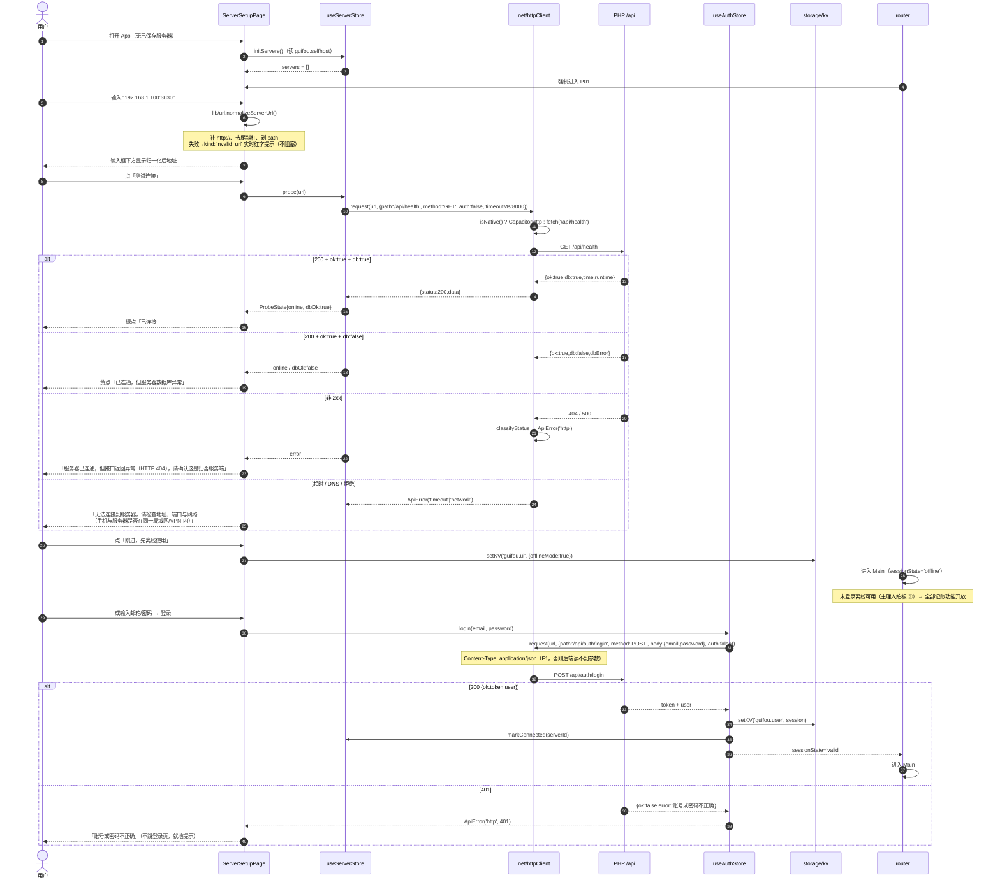
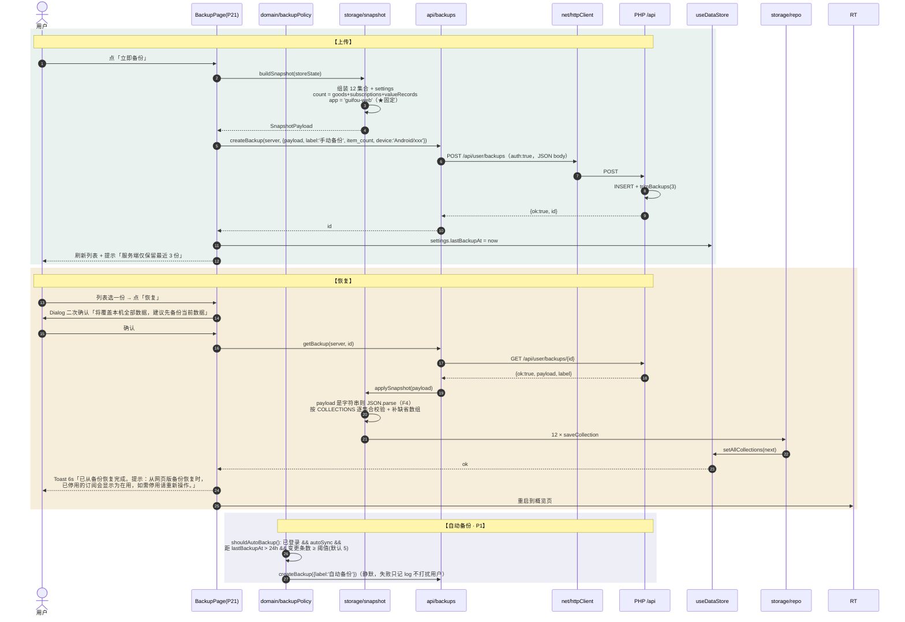
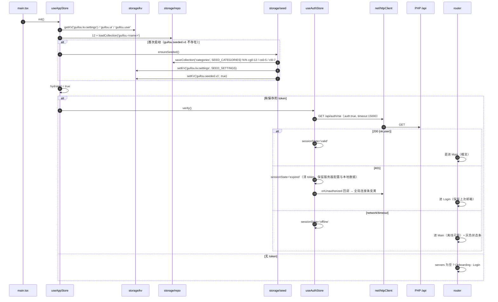
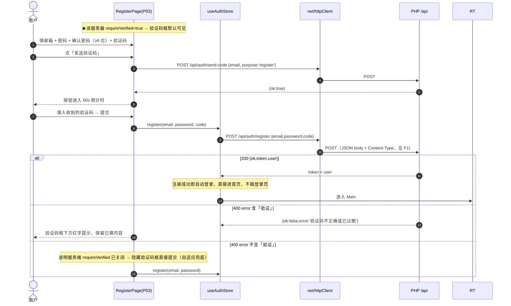
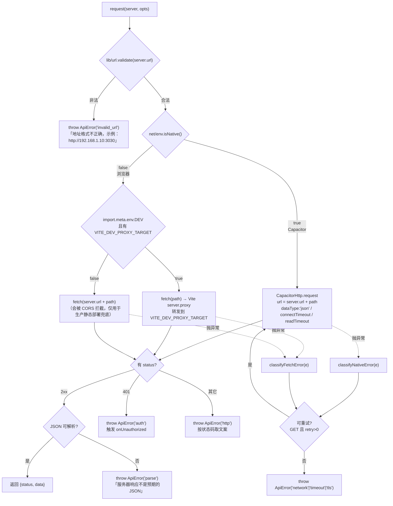
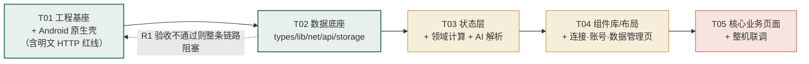

# 归否 Guifou Android App · 系统架构设计与任务分解

> 版本 v1.0 ｜ 撰写：高见远（架构师） ｜ 状态：待工程实现
> 上游输入：`docs/PRD.md`（许清楚）、后端真实源码 `站点根/app/Api.php`（已逐行核对）
> 交付目标：**可运行源码 + 浏览器可跑 + `android/` 原生工程 + 一键构建脚本**（本机无 JDK/SDK，不产 APK）

---

## 0. 架构结论摘要（先读这段）

| 关键问题 | 架构决定 |
| --- | --- |
| R1 后端零 CORS | 网络层**唯一出口** `src/net/httpClient.ts`：原生走 `CapacitorHttp`，浏览器走 `fetch` + Vite `server.proxy`。**组件/页面禁止裸调 fetch/CapacitorHttp** |
| R1 明文 HTTP | `AndroidManifest.xml` 开 `usesCleartextTraffic="true"` + `res/xml/network_security_config.xml`。**漏配真机必挂**，列为 T01 验收红线 |
| R2 无 JDK/SDK | 锁 **Capacitor 7.6.9**（JDK 17 / Gradle 8.x / AGP 8.x），附 `scripts/build-android.bat|.ps1` + `scripts/check-env.mjs` + `docs/BUILD.md` |
| R3 地址不可控 | `src/lib/url.ts` 归一化 + `src/net/errors.ts` 六类错误（invalid_url / network / timeout / tls / http / parse）+ 401 单独归类 auth |
| R4/R5 只留 3 份备份 | `src/domain/backupPolicy.ts`：24h 节流 + 变更阈值；UI 硬编码提示「服务端仅保留最近 3 份」 |
| R5 无 AI 接口 | `src/ai/` 三层：分句 → AI（OpenAI 兼容直连）→ 失败回落 `localParser`（**已从 Web 版构建产物中提取出真实规则并原样移植**） |
| 数据兼容 | 12 集合键名 `guifou.<collection>`、KV 前缀 `guifou.kv.`、快照 `app:"guifou-web"`、ID 算法 `Date.now().toString(36)+random` —— 与 Web 版**字节级一致**（均从 Web 构建产物反查确认，非猜测） |

### 0.1 从后端源码核对出的 5 条「PRD 没写但会致命」的事实

> 这些是我读 `Api.php` / `lib/Support.php` 得到的，工程师必须遵守，否则接口调不通。

| # | 事实 | 证据 | 工程约束 |
| --- | --- | --- | --- |
| F1 | **POST 请求体必须是 JSON**（`Content-Type: application/json`）。`guifou_param()` 只读 `php://input` 并 `json_decode`，**form-urlencoded 会被静默忽略** → 登录报「请输入正确的邮箱地址」 | `Support.php:46-81` | `httpClient` 无条件设 `Content-Type: application/json` + `JSON.stringify(body)` |
| F2 | `GET /api/settings` **需要登录**（未登录直接 401），且返回 `{ok,settings:{...}}`，**不含站点名** | `Api.php:909-920` | P01 引导页**不要**调 `/api/settings` 取品牌名；用本地默认「归否」。登录后（P2）再拉 |
| F3 | `GET /api/health` 返回 `{ok:true, db:bool, dbError, time, runtime}`，**DB 挂了也返回 ok:true** | `Api.php:52-69` | 探测判定：`status===200 && ok===true` → 在线；再判 `db===false` → 黄色「已连通但数据库异常」 |
| F4 | 备份列表返回 **`rows`**（不是 `backups`）；`GET /api/user/backups/:id` 返回 `{ok,payload,label}`，`payload` 可能是**对象也可能是字符串**；删除**首选 `DELETE /api/user/backups/:id`**（后端支持），`POST /api/sync/delete` 仅作旧协议兜底 | `Api.php:290-350` | 反序列化必须兼容两种形态（§7.4）；删除双通道（§7.6） |
| F5 | `POST /api/auth/register` 在 `requireVerified=true` 时才校验 `code`，且**注册成功直接返回 token**（=自动登录）；`reset` 用 `newPassword`；`changepassword` 用 `oldPassword`/`newPassword`。**实测该服务器 `requireVerified=true`（主理人读 `guifou_admin_settings` 确认）** | `Api.php:140-280` | **注册页默认就展示验证码输入框**（不是隐藏）+「发送验证码」按钮与 60s 倒计时；同时保留自适应：若后端返回 400 且 `error` 不含「验证」，说明开关已关闭，此时隐藏验证码框直接提交。密码 ≥6 位 |

---

## 1. 技术选型与版本锁定

### 1.1 运行时与依赖清单（全部经 `npm view` 实测可用）

| 分类 | 包 | 锁定版本 | 理由 |
| --- | --- | --- | --- |
| 容器 | `@capacitor/core` | `7.6.9` | 见 §1.2 |
| 容器 | `@capacitor/cli` | `7.6.9` | 与 core 同版本，避免 `cap sync` 报版本不一致 |
| 容器 | `@capacitor/android` | `7.6.9` | 原生工程模板来源 |
| 插件 | `@capacitor/preferences` | `7.0.4` | 本地 KV 持久化（替代 localStorage） |
| 插件 | `@capacitor/app` | `7.1.2` | 返回键、前后台事件（H-07 / A-08） |
| 插件 | `@capacitor/keyboard` | `7.0.6` | 键盘避让（§5.2） |
| 插件 | `@capacitor/status-bar` | `7.0.6` | 状态栏配色/沉浸式 |
| 插件 | `@capacitor/device` | `7.0.5` | 备份 `device` 字段（`Android/型号`） |
| 插件 | `@capacitor/network` | `7.0.4` | 离线判定，驱动连接状态条 |
| 插件 | `@capacitor/haptics` | `7.0.5` | 轻震动反馈 |
| 插件 | `@capacitor/toast` | `7.0.4` | 原生 Toast（可选，UI 层自绘为主） |
| 插件 | `@capacitor/local-notifications` | `7.0.7` | P1 订阅/保修提醒（D-05） |
| 插件 | `@capacitor/camera` | `7.0.5` | P1 物品图片（C-07） |
| 框架 | `react` / `react-dom` | `18.3.1` | 与 PRD 一致；React 19 虽已发布，但 Capacitor 7 模板与生态示例均为 18，锁定 18 零风险 |
| 构建 | `vite` | `5.4.21` | 稳定线；Vite 8 与 `@vitejs/plugin-react` 6 组合在 Capacitor 静态产物路径上有未知变量，不冒险 |
| 构建 | `@vitejs/plugin-react` | `4.7.0` | 与 Vite 5 匹配 |
| 语言 | `typescript` | `5.9.3` | TS 7 刚发布，锁 5.x |
| 样式 | `tailwindcss` | `3.4.19` | Tailwind 4 改为 CSS-first 配置，与本项目的 `tailwind.config.ts` 令牌映射写法不兼容，锁 3.4 |
| 样式 | `postcss` / `autoprefixer` | `8.5.29` / `10.6.1` | Tailwind 3 必需 |
| 状态 | `zustand` | `5.0.15` | 与 Web 版一致；不引 persist 中间件（存储要精确对齐 Web 键名，手写更可控） |
| 路由 | `react-router-dom` | `6.30.6` | v7 与 React 18 组合变化大；用 `HashRouter` 兼容 `file://` |
| 日期 | `dayjs` | `1.11.23` | 轻量，PRD 指定 |

**不引入**：MUI、ECharts、axios、sqlite、图标字体、lodash。图表全部自绘 SVG。

### 1.2 为什么锁 Capacitor 7.6.9 而不是 8.5.2

| 项 | Capacitor 7.6.9（选） | Capacitor 8.5.2（不选） |
| --- | --- | --- |
| CLI Node 要求 | `>=20.0.0`（本机 22.22.2 ✓） | `>=22.0.0`（本机 ✓） |
| JDK | **17**（PRD §7 R2 已按 JDK 17 写文档） | 21（需用户另装） |
| Android Gradle Plugin | 8.x | 8.9+ |
| compileSdk | 35 | 36（需用户 SDK Manager 额外下载） |
| Kotlin | 1.9.x | 2.x |
| 风险 | 低，官方文档/社区示例充足 | 中高：用户构建机大概率是旧 Android Studio，SDK 36/Gradle 新版可能没有 |

**结论**：锁 7.6.9。在 `docs/BUILD.md` 中写明「Capacitor 8 升级路径」作为后续项。

### 1.3 原生工程环境矩阵（写进 `docs/BUILD.md`）

| 工具 | 版本要求 |
| --- | --- |
| Node.js | `>=20`（本机 22.22.2 ✓） |
| JDK | **17**（Temurin/OpenJDK 均可） |
| Android SDK | `compileSdkVersion 35`、`targetSdkVersion 35`、`minSdkVersion 26` |
| Build-Tools | `35.0.0` |
| Gradle | 8.x（用仓库内 `android/gradle/wrapper` 自带的 wrapper，不依赖系统 gradle） |
| 环境变量 | `ANDROID_HOME`（或 `ANDROID_SDK_ROOT`）、`JAVA_HOME` |

---

## 2. 分层架构

```mermaid
graph TD
    subgraph L1["① UI 层 · src/pages + src/components"]
        P1["页面 pages/*<br/>24 个 PRD 页面"]
        P2["通用组件 components/ui/*"]
        P3["业务组件 components/domain/*"]
        P4["图表 components/charts/*<br/>自绘 SVG"]
        P5["布局壳 components/layout/*<br/>AppShell / TabBar / Fab / ConnectionPill"]
    end

    subgraph L2["② 状态层 · src/store（Zustand）"]
        S1["useAppStore<br/>hydrate / 主题 / 路由守卫"]
        S2["useServerStore<br/>服务器列表 / 当前 / 探测状态"]
        S3["useAuthStore<br/>token / user / sessionState"]
        S4["useDataStore<br/>12 集合 CRUD + 撤销"]
        S5["useSettingsStore<br/>设置 + AI 配置 + lastBackupAt"]
        S6["useUiStore<br/>Toast / Sheet / 确认弹窗"]
    end

    subgraph L3["③ 领域服务层 · src/domain + src/ai"]
        D1["ledger.ts 记帐派生"]
        D2["goods.ts 日均/单次成本"]
        D3["subscription.ts 月均/续费倒计时"]
        D4["stats.ts 报表聚合"]
        D5["backupPolicy.ts 24h 节流"]
        A1["ai/prompt.ts"]
        A2["ai/localParser.ts 规则兜底"]
        A3["ai/parseService.ts 编排"]
    end

    subgraph L4["④ 网络层 · src/net + src/api（唯一 HTTP 出口）"]
        N1["httpClient.ts<br/>CapacitorHttp ⇄ fetch 自动切换"]
        N2["errors.ts 六类错误归一化"]
        N3["env.ts isNative()"]
        N4["aiClient.ts OpenAI 兼容直连"]
        E1["api/auth.ts"]
        E2["api/server.ts health/settings"]
        E3["api/backups.ts"]
        E4["api/user.ts rules/profile"]
    end

    subgraph L5["⑤ 存储层 · src/storage"]
        T1["kv.ts Preferences 封装"]
        T2["repo.ts 12 集合仓库"]
        T3["seed.ts 默认分类种子"]
        T4["snapshot.ts 快照序列化"]
    end

    subgraph L6["⑥ 基础设施 · src/lib + src/types"]
        U1["url.ts 地址归一化"]
        U2["date.ts / money.ts / id.ts / emoji.ts"]
        U3["error.ts ApiError"]
        U4["types/* 全部类型"]
    end

    subgraph EXT["外部"]
        X1[("PHP 后端<br/>/api/*")]
        X2[("第三方 LLM<br/>/chat/completions")]
        X3[("设备存储<br/>Preferences")]
    end

    P1 --> P2 & P3 & P4 & P5
    P1 --> S1 & S2 & S3 & S4 & S5 & S6
    P5 --> S2 & S3
    S4 --> D1 & D2 & D3 & D4 & D5
    S1 --> T1 & T2 & T3
    S2 --> E2
    S3 --> E1
    S5 --> E4
    D5 --> E3
    S4 --> T2 & T4
    E1 & E2 & E3 & E4 --> N1
    N1 --> N2 & N3
    N1 --> U1 & U3
    A3 --> N4
    A3 --> A2
    D1 & D2 & D3 & D4 --> U2
    T1 --> X3
    N1 -.->|CapacitorHttp / fetch+proxy| X1
    N4 -.->|不走 PHP| X2
```



**依赖方向铁律**（Code Review 检查项）

1. 箭头**只能向下**：`pages → store → domain/api → net → storage/lib`。
2. `pages/**` 与 `components/**` **禁止** `import { CapacitorHttp }`、禁止裸 `fetch`、禁止 `import { Preferences }`。
3. `domain/**` 是**纯函数**（输入数据 + 输出派生数据），不读 store、不发请求。
4. `ai/**` 只依赖 `net/aiClient`，**不复用** `net/httpClient`（AI 不经 PHP）。
5. `types/**` 不依赖任何运行时包。

---

## 3. 目录结构与文件清单

> 「行数」为预估（含注释与空行），供工程师排期与自检。

### 3.1 根目录与工程配置

| 路径 | 职责 | 行数 |
| --- | --- | --- |
| `package.json` | 依赖锁定 + scripts（`dev/build/sync/android/preview`) | 75 |
| `vite.config.ts` | base `'./'`、React 插件、`server.proxy['/api']` → `VITE_DEV_PROXY_TARGET` | 60 |
| `tsconfig.json` | strict、`paths: {"@/*": ["src/*"]}` | 35 |
| `tsconfig.node.json` | Vite 配置文件专用 | 12 |
| `tailwind.config.ts` | 令牌映射（`colors.paper` → `var(--paper)` 等）、间距/圆角扩展 | 65 |
| `postcss.config.js` | tailwind + autoprefixer | 8 |
| `index.html` | `viewport-fit=cover`、theme-color、`#root` | 28 |
| `.env.example` | `VITE_DEV_PROXY_TARGET=http://192.168.1.100:3030` | 10 |
| `capacitor.config.ts` | appId `com.guifou.app`、webDir `dist`、`android` 段 | 35 |
| `.gitignore` | node_modules / dist / android/build / .env.local | 22 |
| `README.md` | 30 秒上手：dev 怎么跑、APK 怎么编 | 70 |

### 3.2 原生工程（由 `npx cap add android` 生成后需人工改 5 处）

| 路径 | 职责 | 行数 |
| --- | --- | --- |
| `android/app/src/main/AndroidManifest.xml` | **改**：加 `INTERNET`/`ACCESS_NETWORK_STATE` 权限、`usesCleartextTraffic="true"`、`networkSecurityConfig`、`android:windowSoftInputMode="adjustResize"` | 45 |
| `android/app/src/main/res/xml/network_security_config.xml` | **新增**：允许明文 + 系统信任锚 | 18 |
| `android/app/build.gradle` | **改**：`applicationId`、`versionCode/Name`、`compileOptions 17`、`buildToolsVersion` | 60 |
| `android/variables.gradle` | **改**：`minSdkVersion 26`、`compileSdkVersion 35`、`targetSdkVersion 35` | 25 |
| `android/app/src/main/res/values/styles.xml` | **改**：`windowTranslucentStatus=false`、状态栏背景跟随主题 | 30 |

### 3.3 构建脚本与文档

| 路径 | 职责 | 行数 |
| --- | --- | --- |
| `scripts/check-env.mjs` | 检测 Node/JDK17/`ANDROID_HOME`/SDK Platform 35/Build-Tools，缺失时给出可点击的下载指引并 `exit 1` | 110 |
| `scripts/build-android.bat` | Windows：check-env → `npm ci` → `npm run build` → `npx cap sync android` → `gradlew assembleDebug` → 打印 APK 绝对路径 | 80 |
| `scripts/build-android.ps1` | 同上（PowerShell 版，带彩色输出与 `-SkipTests` 参数） | 80 |
| `docs/BUILD.md` | 前置依赖、首次 `cap add android`、签名发布、常见错误排查表、Capacitor 8 升级路径 | 170 |
| `docs/ARCHITECTURE.md` | 本文档 | — |
| `docs/class-diagram.mermaid` | 类图源文件 | — |
| `docs/sequence-diagram.mermaid` | 时序图源文件 | — |

### 3.4 `src/` 源码

| 路径 | 职责 | 行数 |
| --- | --- | --- |
| `src/main.tsx` | React 挂载、`HashRouter`、`hydrateStore()`、状态栏/安全区初始化 | 50 |
| `src/App.tsx` | 路由守卫（无服务器→Onboarding；有服务器未登录→Login；否则 Main）、全局 Toast/Sheet 挂载点 | 70 |
| `src/router.tsx` | 24 个页面路由表 + 页面转场（200ms 淡入） | 95 |
| `src/index.css` | CSS 变量令牌（浅/深）、`--safe-t/--safe-b`、Tailwind 指令、字号层级、shimmer 动画 | 240 |

**`src/types/`（210）**

| 路径 | 职责 | 行数 |
| --- | --- | --- |
| `src/types/entities.ts` | 12 集合实体类型 + `Judgement`/`CategoryKind`/`Settings` | 190 |
| `src/types/api.ts` | 后端请求/响应 DTO（HealthResp、LoginResp、BackupRow、BackupDetail…） | 130 |
| `src/types/ai.ts` | `AiAction`、`AiDraft`、7 种 draft 结构 | 95 |
| `src/types/index.ts` | 统一 re-export | 10 |

**`src/lib/`（300）**

| 路径 | 职责 | 行数 |
| --- | --- | --- |
| `src/lib/url.ts` | `normalizeServerUrl()`：补协议/去尾斜杠/剥 path/去端口默认值；返回 `{ok,url,reason}` | 70 |
| `src/lib/date.ts` | `today()`、`fmtDate()`、`addDays()`、`monthRange()`、`daysBetween()`、`relativeDayLabel()` | 80 |
| `src/lib/money.ts` | `formatMoney(amount,currency)`、`CURRENCIES`(12 种)、`symbolOf()` | 75 |
| `src/lib/id.ts` | `newId()` = `Date.now().toString(36)+Math.random().toString(36).slice(2,8)`（**与 Web 版同算法**） | 20 |
| `src/lib/emoji.ts` | `emojiForName()`、`CATEGORY_EMOJI_POOL`、`judgementColor()` | 65 |
| `src/lib/error.ts` | `ApiError`、`ErrorKind`、`toHumanMessage(kind,status)` | 80 |
| `src/lib/log.ts` | 脱敏日志（**自动剔除 token/password/key**） | 25 |

**`src/net/`（460）★R1 核心**

| 路径 | 职责 | 行数 |
| --- | --- | --- |
| `src/net/env.ts` | `isNative()`、`isDevProxy()`、`devProxyBase()` | 30 |
| `src/net/errors.ts` | `classifyNativeError(e)` / `classifyFetchError(e)` / `classifyStatus(status,body)` → `ApiError` | 110 |
| `src/net/httpClient.ts` | `request<T>(server, opts)`：环境判定、token 注入、超时、重试、401 回调、JSON 解析兜底 | 230 |
| `src/net/aiClient.ts` | `chatComplete(cfg, messages)`：OpenAI 兼容 `/chat/completions`、JSON 抽取（兼容 ```` ```json ```` 包裹）、20s 超时 | 135 |

**`src/api/`（310）**

| 路径 | 职责 | 行数 |
| --- | --- | --- |
| `src/api/endpoints.ts` | 路径常量 + `NO_AUTH_PATHS` 白名单 | 35 |
| `src/api/server.ts` | `probeHealth()`、`fetchSettings()` | 65 |
| `src/api/auth.ts` | `login/register/sendCode/reset/me/logout/changePassword` | 120 |
| `src/api/backups.ts` | `listBackups/createBackup/getBackup/deleteBackup`（删除首选 `DELETE /api/user/backups/:id`，失败回退 `POST /api/sync/delete`） | 125 |
| `src/api/user.ts` | `getRules/saveRules/getProfile/saveProfile` | 60 |

**`src/storage/`（520）**

| 路径 | 职责 | 行数 |
| --- | --- | --- |
| `src/storage/keys.ts` | 所有本地键名常量（**与 Web 版一致**） | 35 |
| `src/storage/kv.ts` | `getKV/setKV/removeKV`：Preferences + localStorage 兜底 | 95 |
| `src/storage/repo.ts` | `loadCollection/saveCollection` ×12 + `CRUD<T>` 泛型 | 190 |
| `src/storage/seed.ts` | `SEED_CATEGORIES`（cg0-12/cs0-5/cl0-7）、`SEED_SETTINGS`、`ensureSeeded()` | 110 |
| `src/storage/snapshot.ts` | `buildSnapshot()`、`applySnapshot()`（兼容 payload 为对象/字符串） | 130 |

**`src/store/`（760）**

| 路径 | 职责 | 行数 |
| --- | --- | --- |
| `src/store/useAppStore.ts` | `hydrated`、`theme`、`init()`：冷启动 hydrate + 种子 + 自动登录校验 | 90 |
| `src/store/useServerStore.ts` | `servers[]`、`currentId`、`probeState`、`add/update/remove/setCurrent/probe` | 165 |
| `src/store/useAuthStore.ts` | `token`、`user`、`sessionState('unknown'\|'valid'\|'expired'\|'offline')`、`login/logout/verify` | 140 |
| `src/store/useDataStore.ts` | 12 集合 + `addLedger/updateLedger/removeLedger/useGoods+1/retireGoods/addBill/markBillPaid` + `undo()` | 280 |
| `src/store/useSettingsStore.ts` | `settings`、`aiConfig`、`update()`、`lastBackupAt` | 90 |
| `src/store/useUiStore.ts` | `toast(msg,kind)`、`confirm(opts)`、`sheet` | 75 |

**`src/domain/`（560）**

| 路径 | 职责 | 行数 |
| --- | --- | --- |
| `src/domain/ledger.ts` | `groupByDay()`、`filterLedger()`、`sumByJudgement()`、`monthCompare()` | 100 |
| `src/domain/goods.ts` | `dailyCost()`、`perUseCost()`、`holdDays()`、`achieveRate()`、`totalInvest()` | 115 |
| `src/domain/subscription.ts` | `isArchived(sub, settings)`、`monthlyAvg()`、`yearlyAvg()`、`nextRenewCountdown()`、`ensurePendingBills()`（四者按 `id ∈ settings.archivedSubIds` 过滤） | 155 |
| `src/domain/stats.ts` | `categoryShare()`（环图）、`monthlyTrend()`（柱图）、`judgementBreakdown()`、`topCategories()` | 190 |
| `src/domain/backupPolicy.ts` | `shouldAutoBackup()`（24h + 变更阈值 + 开关） | 65 |

**`src/ai/`（570）★R5 核心**

| 路径 | 职责 | 行数 |
| --- | --- | --- |
| `src/ai/cnNumber.ts` | 中文数字 → 阿拉伯数字（`两千=2000`、`一千二=1200`、`三千五=3500`） | 70 |
| `src/ai/split.ts` | `splitSentences()`：按 `[。；;\n]+|，(?=今天|昨天|刚)` 切分并编号 | 65 |
| `src/ai/keywords.ts` | 分类关键词表 `N0`、餐次映射 `S0`/`b0`、交通工具/情绪/时长正则（**Web 版原样移植**） | 130 |
| `src/ai/localParser.ts` | 本地规则解析主函数（金额提取/日期/分类/ judgement） | 240 |
| `src/ai/prompt.ts` | AI 系统提示词（**与 Web 版逐字一致**）+ `buildUserContent()` | 100 |
| `src/ai/parseService.ts` | 编排：分句 → AI → 失败回落 local → 归一化成 `AiDraft[]` | 155 |

**`src/components/ui/`（1 005）**

| 路径 | 职责 | 行数 |
| --- | --- | --- |
| `Button.tsx` | 主/次/文字三态，≥48dp，防重复点击 + 内联 spinner | 65 |
| `Card.tsx` | 16dp 圆角 + `--shadow` | 40 |
| `Sheet.tsx` | 底部弹层，20dp 上圆角、把手、250ms 上滑、遮罩点击关闭 | 115 |
| `Dialog.tsx` | 居中确认弹窗（最大宽 320dp） | 75 |
| `Toast.tsx` | 顶部/底部 Toast，3.5s 自动消失，可带「撤销」按钮 | 95 |
| `Skeleton.tsx` | 骨架屏 shimmer | 40 |
| `EmptyState.tsx` | emoji + 标题 + 说明 + 主按钮 | 55 |
| `Segmented.tsx` | 分段控件（月份/范围切换） | 60 |
| `Chip.tsx` | 分类/judgement 筛选胶囊 | 45 |
| `Switch.tsx` | 自动续费开关 | 55 |
| `Field.tsx` | 输入框（48dp、错误态红边红字） | 95 |
| `NumberPad.tsx` | 自绘数字键盘（金额输入，`inputmode=decimal` 兜底） | 115 |
| `MoneyText.tsx` | 等宽数字金额（`tabular-nums`） | 40 |
| `JudgementPicker.tsx` | **归/需/否** 三个 48dp 色块（核心交互） | 85 |
| `IconButton.tsx` | 视觉 24dp / 热区 44dp | 35 |
| `ListItem.tsx` | 列表行（按压 `--surface-2`） | 50 |
| `ProgressRing.tsx` | 达成率进度环（SVG） | 75 |
| `index.ts` | 统一导出 | 20 |

**`src/components/charts/`（260）**

| 路径 | 职责 | 行数 |
| --- | --- | --- |
| `DonutChart.tsx` | 消费结构环图（SVG arc，点击高亮） | 115 |
| `BarChart.tsx` | 近 6 月柱状趋势（SVG rect） | 95 |
| `StackedBar.tsx` | 归/需/否 三色堆叠条 | 60 |

**`src/components/layout/`（400）**

| 路径 | 职责 | 行数 |
| --- | --- | --- |
| `AppShell.tsx` | 页面骨架：TopBar + 内容区（安全区）+ TabBar + FAB 槽位 | 85 |
| `TopBar.tsx` | 56dp（含状态栏）、居中标题、左右 44dp | 75 |
| `TabBar.tsx` | 5 Tab + 中央 56dp FAB、安全区；双击首页退出 | 95 |
| `Fab.tsx` | 中央悬浮，上移 8dp，点击展开半屏 Sheet | 55 |
| `ConnectionPill.tsx` | 连接状态胶囊（在线/离线/过期/不可达）→ 跳 P05 | 75 |
| `PageContainer.tsx` | 16dp 边距 + 页面转场动画容器 | 45 |

**`src/components/domain/`（410）**

| 路径 | 职责 | 行数 |
| --- | --- | --- |
| `LedgerRow.tsx` | 流水行（图标/备注/金额/judgement 色点） | 75 |
| `GoodsCard.tsx` | 物品卡片（网格/列表双形态、状态徽标、日均成本） | 95 |
| `SubCard.tsx` | 订阅卡片（倒计时、自动续费开关） | 95 |
| `BackupRow.tsx` | 备份行（label/条数/设备/时间 + 恢复/删除） | 65 |
| `ServerCard.tsx` | 服务器卡片（别名/地址/当前标识/上次连接） | 95 |
| `DraftCard.tsx` | AI 解析结果可编辑卡片（P11 用） | 105 |

**`src/pages/onboarding/`（630）**

| 路径 | 对应 PRD 页面 | 行数 |
| --- | --- | --- |
| `ServerSetupPage.tsx` | P01 服务器配置引导（地址 + 测试连接 + 三态结果 + 跳过离线） | 190 |
| `LoginPage.tsx` | P02 登录（记住我、错误区） | 165 |
| `RegisterPage.tsx` | P03 注册（**默认展示验证码框 + 发送验证码 60s 倒计时**，见 §0.1 F5） | 165 |
| `ForgotPasswordPage.tsx` | P04 忘记密码（60s 倒计时） | 145 |

**`src/pages/`（3 360，20 个页面）**

| 路径 | 对应 PRD 页面 | 行数 |
| --- | --- | --- |
| `OverviewPage.tsx` | P07 概览 | 230 |
| `ReportPage.tsx` | P08 报表 | 225 |
| `LedgerPage.tsx` | P09 生活流 | 205 |
| `ManualRecordSheet.tsx` | P12/P13 记一笔（手动）/编辑 | 205 |
| `AiPage.tsx` | P10 AI 助手 | 165 |
| `AiConfirmPage.tsx` | P11 解析结果确认 | 205 |
| `GoodsListPage.tsx` | P14 物品库 | 205 |
| `GoodsDetailPage.tsx` | P15 物品详情 | 225 |
| `GoodsEditPage.tsx` | P16 物品编辑/新增 | 265 |
| `SubListPage.tsx` | P17 订阅列表 | 195 |
| `SubEditPage.tsx` | P18 订阅详情/编辑 | 245 |
| `SubBillsPage.tsx` | P19 订阅账单流水 | 125 |
| `MePage.tsx` | P20 我的 | 185 |
| `ServerManagePage.tsx` | P05 服务器管理 | 175 |
| `ServerEditPage.tsx` | P06 服务器编辑/新增 | 155 |
| `BackupPage.tsx` | P21 备份与恢复 | 205 |
| `SettingsPage.tsx` | P22 设置（AI/主题/货币/自动备份） | 205 |
| `ProfilePage.tsx` | P23 账号资料/改密 | 135 |
| `CategoryPage.tsx` | P24 分类管理 | 155 |

**`src/hooks/`（300）**

| 路径 | 职责 | 行数 |
| --- | --- | --- |
| `useHydrate.ts` | 冷启动：读 KV → 装集合 → 种子 → 自动登录校验 | 90 |
| `useConnectionProbe.ts` | 探测 + 前后台/网络变化时重新探测 | 95 |
| `useBackButton.ts` | Android 返回键：Tab 首页双击退出、子页返回栈 | 70 |
| `useAutoBackup.ts` | 登录 + 24h + 变更 → 静默备份 | 75 |

**合计 ≈ 90 个文件 / ≈ 9 500 行。**

---

## 4. 核心数据结构（TypeScript）

### 4.1 实体（`src/types/entities.ts`）

```ts
export type Judgement = 'gui' | 'xu' | 'fou';          // 归 / 需 / 否
export type CategoryKind = 'goods' | 'sub' | 'ledger';

export interface Category {
  id: string;            // cg0..cg12 | cs0..cs5 | cl0..cl7
  name: string;
  icon: string;          // 单个 emoji
  kind: CategoryKind;
  order: number;
}

/** ★核心：生活流 */
export interface ValueRecord {
  id: string;
  type: 'expense' | 'income';
  amount: number;
  currency: string;                 // 默认 'CNY'
  date: string;                     // 'YYYY-MM-DD'
  categoryId: string;               // cl0..cl7
  judgement: Judgement;
  note?: string;
  createdAt: string;                // ISO
}

export interface Goods {
  id: string; name: string; categoryId: string;        // cg0..cg12
  tags: string[]; price: number; currency: string;
  buyDate: string;                                      // 'YYYY-MM-DD'
  status: 'active' | 'retired' | 'favorite';
  image?: { source: string; ref: string };              // P0: {source:'system', ref:'🎧'}
  note?: string;
  extraFees: { name: string; amount: number }[];
  incomes: unknown[];
  sellPrice?: number;
  targetDailyCost?: number;
  countEnabled?: boolean; totalCount?: number; usedCount?: number;
  warrantyDate?: string;
  warrantyRemind?: { on: boolean; leadDays: number; time: string };
  createdAt: string; updatedAt: string;
}

export interface Subscription {
  id: string; name: string; categoryId: string;         // cs0..cs5
  icon: string; currency: string;
  type: 'recurring' | 'lifetime';
  period: 'month' | 'year' | 'week';
  every: number; amount: number;
  startDate: string; nextRenewDate: string;
  autoRenew: boolean; initSpent?: number;
  status: string;                                       // 恒为 'active'（不加 paused，主理人拍板）
  remind: { renewLead: number };                        // 默认 { renewLead: 3 }
  createdAt: string; updatedAt: string;
  // 注意：不在这里加归档字段 —— 见下方 ★约定
}

/**
 * ★「停用/归档」存储约定（PRD v0.2 D-06）  【v1.1 修订，主理人提供 Web 端恢复代码证据】
 * - 不引入 paused：Subscription.status 恒为 'active'，与 Web 版数据模型一致。
 * - 归档状态**不写在 Subscription 上**，而是写在 settings 的 `archivedSubIds: string[]`（存已停用订阅的 id）。
 * - 依据（Web 端 `index-B8gRSd40.js` 恢复逻辑）：
 *     cloud:  T?.collections && (replaceAll(T.collections), T.settings && patchSettings(T.settings))
 *     local:  P?.collections && (replaceAll(P.collections), P.settings && patchSettings({...Pr, ...P.settings}))
 *   → collections 是**整体替换**，记在单条记录上的自定义字段必丢；
 *     settings 是 **patchSettings 合并展开**，未知键会保留 → 自定义键能跟着备份走。
 * - 语义：id ∈ archivedSubIds 的订阅 → 移出在用列表、不计入月均/年均、不触发续费提醒、保留历史账单；移除 id 即恢复。
 * - 残留降级：若从**不含该键的旧备份**恢复，`archivedSubIds` 会缺失 → 已停用的订阅显示为在用（走 §7.4 的提示文案）。
 */
export function isArchived(s: Subscription, st: Pick<Settings, 'archivedSubIds'>): boolean {
  return !!st.archivedSubIds?.includes(s.id);
}

export interface Bill {
  id: string; subId: string; dueDate: string;
  amount: number; currency: string;
  status: 'paid' | 'pending'; paidDate?: string;
  refund?: number; createdAt: string;
}

export interface Mood   { id: string; feeling: string; text: string; crushed: boolean; inHeart: boolean; date: string; createdAt?: string; }
export interface TimeRec{ id: string; durationMin: number; tags: string[]; meaning: Judgement; date: string; note?: string; createdAt?: string; }
export interface UsageRecord { id: string; goodsId: string; date: string; createdAt: string; }
export interface WishItem { id: string; name: string; price?: number; url?: string; note?: string; createdAt: string; }
export interface Cooldown { id: string; name: string; until: string; createdAt: string; }
export interface Reminder { id: string; kind: 'goods_warranty' | 'sub_renew'; refId: string; at: string; done: boolean; createdAt: string; }
export interface Wall    { id: string; text: string; color?: string; createdAt: string; }

/** 12 个集合名的有序常量（快照与恢复都按此顺序） */
export const COLLECTIONS = [
  'goods','subscriptions','bills','valueRecords','moods','times',
  'wishlist','cooldowns','categories','usageRecords','reminders','walls',
] as const;
export type CollectionName = typeof COLLECTIONS[number];
```

### 4.2 设置（与 Web 版默认值逐字段一致，从构建产物反查确认）

```ts
export interface Settings {
  baseCurrency: string;      // 'CNY'
  currency: string;          // 'CNY'
  rates: Record<string, number>;
  ratesUpdatedAt: string;
  includeRetired: boolean;   // false
  useDepreciation: boolean;  // false
  theme: 'system' | 'light' | 'dark';   // 'system'
  palette: 'moss';           // 'moss'
  showIcon: boolean;         // true
  showBuyDate: boolean;      // true
  showWarrantyCountdown: boolean; // true
  formatDaysAsYmd: boolean;  // false
  vibrate: boolean;          // true
  reminderMaster: boolean;   // true
  homeTab: string;           // 'goods'
  viewMode: 'list' | 'grid'; // 'list'
  sortBy: string;            // 'buyDate'
  lastBackupAt: string;      // ''
  autoSync: boolean;         // true
  aiEndpoint: string;        // ''
  aiKey: string;             // ''
  aiModel: string;           // 'gpt-4o-mini'
  archivedSubIds?: string[]; // ★App 端扩展键（默认 []）：已停用/归档的订阅 id 列表，见 §4.1 ★约定
}
```

> `archivedSubIds` 是**唯一**允许往 `Settings` 上新增的 App 端自定义键，且必须是可选键：Web 版不认识它但 `patchSettings` 会保留，反之 App 读到不含该键的 settings 时按 `[]` 处理。

### 4.3 服务器 / 会话 / 连接

```ts
export interface ServerConfig {
  id: string;             // 'srv_' + newId()
  alias: string;          // 「家里服务器」
  url: string;            // 归一化后：'http://192.168.1.100:3030'（无尾斜杠、无 path）
  note?: string;
  createdAt: string;
  lastConnectedAt?: string;   // ISO
  lastOk?: boolean;
}

export type SessionState = 'unknown' | 'valid' | 'expired' | 'offline';
export interface Session { token: string; user: UserInfo; savedAt: string; }
export interface UserInfo { id: string; email: string; display_name: string | null; verified: boolean; }

export type ProbeState =
  | { kind: 'idle' }
  | { kind: 'probing' }
  | { kind: 'online';  dbOk: boolean; serverTime: string }
  | { kind: 'error';   error: ApiError };
```

### 4.4 备份快照（`src/types/api.ts`）

```ts
export interface SnapshotPayload {
  collections: Record<CollectionName, unknown[]>;
  settings: Settings | null;
  count: number;              // = goods + subscriptions + valueRecords 的条数（与 Web 版同口径）
  app: 'guifou-web';          // ★固定值，主理人拍板：不得写 guifou-android
  version: 1;
  exportedAt: string;         // ISO
}
export interface CreateBackupBody { payload: SnapshotPayload; label: string; item_count: number; device: string; }
export interface BackupRow { id: number; label: string; item_count: number; bytes: number; device: string; created_at: string; }
export interface BackupDetail { payload: SnapshotPayload | string; label: string; }   // ★payload 可能是字符串（F4）
```

### 4.5 AI 草稿（`src/types/ai.ts`）

```ts
export type AiAction =
  | 'create_goods' | 'create_subscription' | 'create_ledger'
  | 'create_mood'  | 'create_time' | 'retire_sell' | 'unknown';

export interface AiResultItem {
  action: AiAction;
  goodsDraft?: { name: string; price: number; currency: string; buyDate: string; categoryId: string; icon: string; tags: string[]; note?: string };
  subDraft?:   { name: string; amount: number; currency: string; period: 'month'|'year'|'week'; every: number; categoryId: string; icon: string };
  ledgerDraft?:{ type: 'expense'|'income'; amount: number; categoryId: string; judgement: Judgement; date: string; note: string };
  moodDraft?:  { feeling: string; text: string };
  timeDraft?:  { durationMin: number; tags: string[]; meaning: Judgement; note: string };
  retireDraft?:{ match: string; sellPrice: number };
  explanation?: string;
  source: 'ai' | 'local';
}

/** P11 确认页用的可编辑草稿（AI 结果 + 用户勾选 + 用户改写） */
export interface DraftItem {
  key: string;              // 行内唯一
  checked: boolean;
  item: AiResultItem;
  edit?: Partial<AiResultItem['ledgerDraft']>;   // 用户编辑后的字段
}
```

### 4.6 统一错误（`src/lib/error.ts`）

```ts
export type ErrorKind =
  | 'invalid_url'   // 地址不合法（归一化失败）
  | 'network'       // DNS 失败 / 连接被拒 / 无网络
  | 'timeout'       // 超时
  | 'tls'           // 证书不受信任（自签）
  | 'http'          // 有状态码但非 2xx
  | 'auth'          // 401（含 403 requireVerified 场景按 http 处理）
  | 'parse';        // 200 但不是预期 JSON

export class ApiError extends Error {
  constructor(
    public kind: ErrorKind,
    public message: string,     // 人类可读中文文案（直接给 UI 用）
    public status?: number,
    public raw?: unknown,
  ) { super(message); }
}
```

---

## 5. 关键流程时序图

### 5.1 ① 首次启动：配置服务器 → 测试连接 → 登录



### 5.2 ② 记一笔：AI 解析 → 多条确认 → 落库

```mermaid
sequenceDiagram
    autonumber
    actor U as 用户
    participant AI as AiPage(P10)
    participant PS as ai/parseService
    participant AC as net/aiClient
    participant LLM as 第三方 LLM
    participant LP as ai/localParser
    participant CP as AiConfirmPage(P11)
    participant DS as useDataStore
    participant RP as storage/repo

    U->>AI: 「今天早上吃了油条包子花了30，然后坐火车花了60去桐柏」
    AI->>PS: parse(text, categories, settings)
    PS->>PS: splitSentences(text) → ["今天早上吃了油条包子花了30","坐火车花了60去桐柏"]

    alt 已配置 aiEndpoint + aiKey
        PS->>AC: chatComplete(cfg, [system: prompt.ts, user: 编号分句])
        AC->>LLM: POST {base}/chat/completions（CapacitorHttp，不经 PHP）
        LLM-->>AC: choices[0].message.content（可能带 ```json 包裹）
        AC->>AC: extractJsonArray()
        AC-->>PS: AiResultItem[]
        Note over PS: source = 'ai'
    else 未配置 / 调用失败 / JSON 非法
        AC-->>PS: throw
        PS->>LP: parseLocal(text, categories)
        LP->>LP: 金额提取 → 餐次识别 → 分类匹配 → judgement 判定
        LP-->>PS: AiResultItem[]
        Note over PS: source = 'local'，UI 显式提示「由本地规则解析（未配置 AI）」
    end

    PS->>PS: normalize(items)（补全 currency/date/categoryId，过滤 unknown）
    PS-->>AI: AiResultItem[]
    AI->>CP: navigate('/ai/confirm', {items})

    CP-->>U: 2 张可勾选卡片（金额/分类/日期/备注/judgement 可编辑）
    U->>CP: 勾选 → 改第 2 条 judgement 为「归」→ 点「保存这 2 条」
    CP->>DS: addLedger(draft1); addLedger(draft2)
    DS->>RP: saveCollection('valueRecords', [...])
    RP->>RP: Preferences.set('guifou.valueRecords', JSON)
    DS-->>CP: ok
    CP->>U: Toast「已保存 2 条」+ Haptics 轻震动
    CP->>RT: 回生活流并定位到今天
```

### 5.3 ③ 云备份上传 / 恢复



### 5.4 ④ 冷启动 hydrate + 登录态校验



### 5.5 ⑤ 注册（**默认走验证码**，实测 `requireVerified=true`）



> 登录侧同理：若返回 **403「邮箱尚未验证」**，不报错，内联展开验证码区，验证通过后**自动重试登录**（PRD v0.2 A-06）。

---

## 6. 网络层设计（★R1/R3 唯一解法）

### 6.1 统一接口签名

```ts
// src/net/httpClient.ts
export interface RequestOptions {
  method?: 'GET' | 'POST' | 'DELETE';       // 默认 'GET'
  path: string;                              // 必须以 '/api' 开头
  body?: unknown;                            // 会被 JSON.stringify
  query?: Record<string, string | number>;
  timeoutMs?: number;                        // 默认 15000；health 用 8000
  auth?: boolean;                            // 默认 true → 注入 Bearer
  retry?: number;                            // 默认：GET=1，其它=0
  signal?: AbortSignal;                      // 仅 fetch 分支生效
}

export interface HttpResponse<T> { status: number; data: T; }

export declare function request<T = any>(
  server: Pick<ServerConfig, 'url'>,
  opts: RequestOptions,
): Promise<HttpResponse<T>>;   // 失败 throw ApiError

export declare function setUnauthorizedHandler(fn: (err: ApiError) => void): void;
```

### 6.2 环境判定与分支



### 6.3 三类错误（R3）判定与文案

| kind | 判定条件 | UI 文案（原样写入 `toHumanMessage`） |
| --- | --- | --- |
| `invalid_url` | `normalizeServerUrl()` 返回失败（无协议且不含 `.`/`:`、含空格、协议非 http(s)） | `地址格式不正确，示例：http://192.168.1.10:3030` |
| `timeout` | CapacitorHttp 异常含 `timeout`/`timed out`/`SocketTimeout`；fetch `AbortError` 且 reason=timeout | `连接超时（8s），请确认手机与服务器在同一局域网或已连 VPN` |
| `network` | CapacitorHttp 异常含 `UnknownHost`/`ConnectException`/`ECONNREFUSED`/`Failed to connect`；fetch `TypeError: Failed to fetch` | `无法连接到服务器，请检查地址、端口与网络（是否在同一个局域网/VPN 内）` |
| `tls` | 异常含 `SSL`/`SSLHandshake`/`certificate`/`trust anchor`/`Not trusted` | `HTTPS 证书不受信任（多为自签证书），请改用 http 或在系统内安装该证书` |
| `http` | 有 status 且 `status < 200 || >= 300` | 见下表 |
| `auth` | `status === 401` | `登录已过期，请重新登录` |
| `parse` | status 2xx 但 body 非 JSON / 缺 `ok` 字段 | `服务器已连通，但返回内容不是归否服务端（HTTP ${status}）` |

`http` 子文案：

| status | 文案 |
| --- | --- |
| 403 | `服务器拒绝了请求（403）：可能是账号未验证或已被停用` |
| 404 | `接口不存在（404），请确认这是归否服务端` |
| 405 | `请求方法不被支持（405）` |
| 5xx | `服务器内部错误（${status}），请稍后重试` |
| 其它 | `请求失败（${status}）：${error ?? '未知错误'}` |

> 后端 `guifou_fail` 统一返回 `{ok:false,error:"中文原因"}`，**优先展示 `error` 字段**（如「账号或密码不正确」「密码至少 6 位」），只在没有 `error` 时才用上表兜底文案。

### 6.4 `health` 的三态判定（A-03）

```ts
// src/api/server.ts
export async function probeHealth(server: ServerConfig): Promise<ProbeState> {
  const res = await request<HealthResp>(server, { path: '/api/health', auth: false, timeoutMs: 8000 });
  if (res.status === 200 && res.data?.ok === true) {
    return { kind: 'online', dbOk: res.data.db !== false, serverTime: res.data.time };
  }
  throw new ApiError('parse', '服务器已连通，但接口返回异常，请确认这是归否服务端', res.status, res.data);
}
```

UI 映射：`online && dbOk` → 绿；`online && !dbOk` → 黄「已连通，但服务器数据库未连接」；`error` → 按 §6.3 三态。

### 6.5 Token 注入与 401

- 注入：`auth !== false` 时读 `useAuthStore.getState().session?.token`，写入 `Authorization: Bearer <token>`。
- 白名单（`NO_AUTH_PATHS`）：`/api/health`、`/api/auth/login`、`/api/auth/register`、`/api/auth/send-code`、`/api/auth/reset`。
  其余（含 `/api/settings`）**一律带 token**（F2：settings 需要登录）。
- 401 处理：`httpClient` 捕获后先 `throw ApiError('auth')`，**同时**调用 `setUnauthorizedHandler` 注册的回调 → `useAuthStore.markExpired()`（清 token、`sessionState='expired'`、**保留本地业务数据与服务器配置**）→ 连接状态条变黄 → 若当前不在登录页则 `navigate('/login')`。

### 6.6 超时与重试

| 场景 | 超时 | 重试 |
| --- | --- | --- |
| `GET /api/health`（探测） | 8 000 ms | 0（用户主动点，快速反馈更重要） |
| 其它 GET | 15 000 ms | 1 次，间隔 400 ms，仅 `network`/`timeout` |
| POST / DELETE | 15 000 ms | 0（非幂等，避免重复创建备份） |
| AI `/chat/completions` | 20 000 ms | 0（失败立即回落本地规则） |

### 6.7 CapacitorHttp 调用要点（工程师必读）

```ts
const res = await CapacitorHttp.request({
  url: `${server.url}${path}${qs}`,
  method: opts.method ?? 'GET',
  headers: {
    'Content-Type': 'application/json',     // ★F1：后端只解析 JSON body
    Accept: 'application/json',
    ...(token ? { Authorization: `Bearer ${token}` } : {}),
  },
  data: opts.body,                           // 对象即可（dataType:'json' 会自动序列化）
  dataType: 'json',                          // 响应按 JSON 解析；非 JSON 时回落为字符串
  connectTimeout: timeoutMs,
  readTimeout: timeoutMs,
  shouldEncodeUrlParams: false,              // query 自己拼，避免二次编码
});
// 返回：{ status, headers, data, url }
```

**坑位清单**

1. `dataType:'json'` 时 `res.data` 可能是**字符串**（后端返回非 JSON），解析层必须 `typeof data === 'string' ? safeParse(data) : data`。
2. CapacitorHttp **不带 cookie**，会话完全靠 Bearer。
3. 异常对象形态不统一（Android 抛 `Error`，message 含 Java 异常类名），只能做**关键词匹配**分类（§6.3）。
4. 真机明文 HTTP 失败 99% 是 Manifest / network_security_config 没配（§8）。
5. 日志：所有请求/响应经 `lib/log.ts` 脱敏（剔除 `token/password/key/Authorization`）。

---

## 7. 存储层设计

### 7.1 键名（**与 Web 版完全一致**，从构建产物反查确认）

| 键 | 内容 | 来源 |
| --- | --- | --- |
| `guifou.goods` … `guifou.walls` | 12 个集合，各存一个 JSON 数组 | Web 版 `localStorage.getItem('guifou.<name>')` |
| `guifou.kv.settings` | `Settings` | Web 版 KV 前缀 `guifou.kv.` |
| `guifou.kv.servers` | `ServerConfig[]` | 新增 |
| `guifou.kv.backupMeta` | `{lastBackupAt, lastCount}` | 新增 |
| `guifou.user` | `Session`（token + user） | Web 版 |
| `guifou.selfhost` | 当前服务器（镜像，便于 Web 版兼容） | Web 版 |
| `guifou.ui` | `{offlineMode, homeTab, lastRoute}` | Web 版 |
| `guifou.parse.rules` | 自定义识别规则 JSON | Web 版 |
| `guifou.rates.v2` | 汇率表 | Web 版 |
| `guifou.seeded.v1` | 是否已灌种子 | Web 版 |

### 7.2 持久化实现

```ts
// src/storage/kv.ts —— Preferences 优先，Web 回落 localStorage
async function platformGet(key: string): Promise<string | null> {
  if (isNative()) return (await Preferences.get({ key })).value;
  return localStorage.getItem(key);
}
```

- Android 侧为 `SharedPreferences`；**一个集合一个 key**，避免单个 value 过大（>1MB 会有性能问题）。
- 写策略：`useDataStore` 的每个 mutation 后**同步写内存**并 **debounce 300ms 落盘**（`repo.saveCollection`），冷启动再全量 hydrate。
- 冷启动性能：12 个集合一次性并发读，目标 < 1.5s；`hydrated` 之前显示启动骨架。

### 7.3 默认分类种子（完整数据，直接抄进 `seed.ts`）

```ts
// src/storage/seed.ts
export const SEED_CATEGORIES: Category[] = [
  // goods —— cg0..cg12
  { id:'cg0', name:'数码', icon:'📱', kind:'goods', order:0 },
  { id:'cg1', name:'衣物', icon:'👕', kind:'goods', order:1 },
  { id:'cg2', name:'家居', icon:'🛋️', kind:'goods', order:2 },
  { id:'cg3', name:'美妆', icon:'💄', kind:'goods', order:3 },
  { id:'cg4', name:'厨房', icon:'🍳', kind:'goods', order:4 },
  { id:'cg5', name:'运动', icon:'🏀', kind:'goods', order:5 },
  { id:'cg6', name:'交通', icon:'🚲', kind:'goods', order:6 },
  { id:'cg7', name:'家电', icon:'🧊', kind:'goods', order:7 },
  { id:'cg8', name:'工具', icon:'🛠️', kind:'goods', order:8 },
  { id:'cg9', name:'玩具', icon:'🧸', kind:'goods', order:9 },
  { id:'cg10',name:'乐器', icon:'🎸', kind:'goods', order:10 },
  { id:'cg11',name:'珠宝', icon:'💍', kind:'goods', order:11 },
  { id:'cg12',name:'日用', icon:'🧴', kind:'goods', order:12 },
  // sub —— cs0..cs5
  { id:'cs0', name:'影音', icon:'🎬', kind:'sub', order:0 },
  { id:'cs1', name:'效率', icon:'⚡️', kind:'sub', order:1 },
  { id:'cs2', name:'学习', icon:'📚', kind:'sub', order:2 },
  { id:'cs3', name:'云服务',icon:'☁️', kind:'sub', order:3 },
  { id:'cs4', name:'游戏', icon:'🎮', kind:'sub', order:4 },
  { id:'cs5', name:'生活', icon:'🌿', kind:'sub', order:5 },
  // ledger —— cl0..cl7
  { id:'cl0', name:'餐饮', icon:'🍜', kind:'ledger', order:0 },
  { id:'cl1', name:'交通', icon:'🚌', kind:'ledger', order:1 },
  { id:'cl2', name:'居住', icon:'🏠', kind:'ledger', order:2 },
  { id:'cl3', name:'学习', icon:'📖', kind:'ledger', order:3 },
  { id:'cl4', name:'健康', icon:'💊', kind:'ledger', order:4 },
  { id:'cl5', name:'娱乐', icon:'🎧', kind:'ledger', order:5 },
  { id:'cl6', name:'人情', icon:'🎁', kind:'ledger', order:6 },
  { id:'cl7', name:'其他', icon:'🧾', kind:'ledger', order:7 },
];
```

> 规则：`ledger` 八分类**不可删除、不可改名**，仅可改图标与排序（P24）；`goods`/`sub` 可自由增删改。

### 7.4 快照序列化 / 反序列化

```ts
// src/storage/snapshot.ts
export function buildSnapshot(s: DataState & { settings: Settings }): SnapshotPayload {
  const collections = {} as Record<CollectionName, unknown[]>;
  for (const c of COLLECTIONS) collections[c] = s[c] ?? [];
  const count = collections.goods.length + collections.subscriptions.length + collections.valueRecords.length;
  return {
    collections,
    settings: s.settings,
    count,                       // ★只算 3 个集合，与 Web 版同口径
    app: 'guifou-web',           // ★固定值
    version: 1,
    exportedAt: new Date().toISOString(),
  };
}

export function applySnapshot(raw: SnapshotPayload | string): Partial<DataState> {
  const p = typeof raw === 'string' ? JSON.parse(raw) : raw;     // ★F4 兼容
  if (!p || typeof p !== 'object' || !p.collections) throw new ApiError('parse', '备份内容无法识别');
  const next: any = {};
  for (const c of COLLECTIONS) {
    const arr = p.collections[c];
    next[c] = Array.isArray(arr) ? arr : [];                     // 缺失集合补空数组，绝不中断
  }
  if (p.settings && typeof p.settings === 'object') next.settings = { ...DEFAULT_SETTINGS, ...p.settings };
  return next;
}
```

**上传体**（`POST /api/user/backups`，与 Web 版一致）：

```json
{ "payload": { "collections": { ... }, "settings": { ... }, "count": 128, "app": "guifou-web", "version": 1, "exportedAt": "2026-10-06T08:00:00.000Z" },
  "label": "手动备份", "item_count": 128, "device": "Android/Pixel 8" }
```

`device` 用 `Device.getInfo()` 拼 `` `Android/${model || 'Device'}` ``，截断 60 字符（后端 `guifou_str(...,110)`，Web 版截 60）。

**恢复完成提示文案**（主理人已定稿，归属文件 `src/pages/BackupPage.tsx`，工程师直接抄）：

```ts
// 恢复成功后（仅在「快照里含订阅」时才追加第二行说明）
const hasSub = (applied.subscriptions?.length ?? 0) > 0;
toast({
  message: hasSub
    ? '已从备份恢复完成。提示：从网页版备份恢复时，已停用的订阅会显示为在用，如需停用请重新操作。'
    : '已从备份恢复完成。',
  duration: hasSub ? 6000 : 3500,   // 文案较长时延长到 6s
});
```

> **措辞红线**：第二行是**信息补充**，不得写成「恢复失败 / 部分失败 / 数据不完整」——恢复是完整成功的，只是归档标记可能不在旧快照里。
>
> 背景：归档状态存在 `settings.archivedSubIds`（§4.1 ★约定），从**不含该键的旧备份**恢复时会缺失 → 已停用的订阅显示为在用。方案为「不做补偿 + 让用户知情」。

### 7.5 自动备份节流（R4/R5）

```ts
// src/domain/backupPolicy.ts
export function shouldAutoBackup(s: {
  loggedIn: boolean; autoSync: boolean; lastBackupAt: string; changedSinceBackup: number;
}): boolean {
  if (!s.loggedIn || !s.autoSync) return false;
  if (s.changedSinceBackup < 5) return false;                       // 变更阈值
  if (!s.lastBackupAt) return true;
  return Date.now() - new Date(s.lastBackupAt).getTime() > 24 * 3600 * 1000;  // 24h 节流
}
```

UI 硬要求：备份页顶部常驻提示条 **「服务端仅保留最近 3 份备份，重要数据请定期本地导出」**。

### 7.6 删除备份：双通道（PRD v0.2 G-05）

```ts
// src/api/backups.ts
export async function deleteBackup(server: ServerConfig, id: number): Promise<void> {
  try {
    await request(server, { method: 'DELETE', path: `/api/user/backups/${id}` });   // 首选（更规范）
  } catch (e) {
    // 405 / 404 / 代理不支持 DELETE → 回退旧协议
    await request(server, { method: 'POST', path: '/api/sync/delete', body: { id } });
  }
}
```

> 注意：`request()` 的 `method` 联合类型需包含 `'DELETE'`（已在 §6.1 定义）。两条通路都会触发后端 `trimBackups(3)` 语义无关，UI 刷新列表即可。

---

## 8. Android 原生壳配置要点

### 8.1 `capacitor.config.ts`

```ts
import type { CapacitorConfig } from '@capacitor/cli';

const config: CapacitorConfig = {
  appId: 'com.guifou.app',
  appName: '归否',
  webDir: 'dist',
  loggingEnabled: false,
  android: {
    // Capacitor 7 默认 androidScheme: 'https'，页面源 https://localhost
    // 业务请求走 CapacitorHttp（原生层），不受 WebView 同源策略影响
    allowMixedContent: true,          // 允许 https 页面内引用 http 资源（缩略图等）
    captureInput: true,
    webContentsDebuggingEnabled: false,   // 发布版务必 false
  },
  plugins: {
    Keyboard: { resizeOnFullScreen: true, resize: 'body' },   // 配合 adjustResize
  },
};
export default config;
```

### 8.2 `AndroidManifest.xml`（**★R1 关键**）

```xml
<manifest xmlns:android="http://schemas.android.com/apk/res/android">
  <uses-permission android:name="android.permission.INTERNET" />
  <uses-permission android:name="android.permission.ACCESS_NETWORK_STATE" />
  <!-- P1 通知 -->
  <uses-permission android:name="android.permission.POST_NOTIFICATIONS" />
  <!-- P1 拍照/相册（用 Camera 插件自带 FileProvider，勿手写 authorities） -->
  <uses-permission android:name="android.permission.READ_MEDIA_IMAGES" />

  <application
      android:usesCleartextTraffic="true"                       <!-- ★允许 http 明文 -->
      android:networkSecurityConfig="@xml/network_security_config"  <!-- ★ -->
      android:hardwareAccelerated="true"
      android:icon="@mipmap/ic_launcher"
      android:label="@string/app_name"
      android:theme="@style/AppTheme">

    <activity
        android:name=".MainActivity"
        android:exported="true"
        android:launchMode="singleTask"
        android:windowSoftInputMode="adjustResize"              <!-- ★键盘避让 -->
        android:theme="@style/AppTheme.NoActionBarLaunch">
      <intent-filter>
        <action android:name="android.intent.action.MAIN" />
        <category android:name="android.intent.category.LAUNCHER" />
      </intent-filter>
    </activity>
  </application>
</manifest>
```

### 8.3 `res/xml/network_security_config.xml`（新增）

```xml
<?xml version="1.0" encoding="utf-8"?>
<network-security-config>
  <!-- 允许明文：内网 http://192.168.1.100:3030 这类地址必须 -->
  <base-config cleartextTrafficPermitted="true">
    <trust-anchors>
      <certificates src="system" />
    </trust-anchors>
  </base-config>
  <!-- 自签证书：默认不信任。如需支持，由用户在系统内安装 CA，不要在这里加 user -->
</network-security-config>
```

> 说明：自签 HTTPS 证书**默认不允许**跳过校验（安全底线），命中时走 §6.3 `tls` 文案引导用户改用 http 或安装证书。

### 8.4 `android/variables.gradle`

```groovy
ext {
    minSdkVersion = 26        // Android 8.0+（PRD §0）
    compileSdkVersion = 35
    targetSdkVersion = 35
    androidxActivityVersion = '1.9.2'
    androidxAppCompatVersion = '1.7.0'
    androidxCoordinatorLayoutVersion = '1.2.0'
    androidxCoreVersion = '1.15.0'
    androidxFragmentVersion = '1.8.5'
    coreSplashScreenVersion = '1.0.1'
    androidxWebkitVersion = '1.12.1'
    junitVersion = '4.13.2'
    androidxJunitVersion = '1.2.1'
    androidxEspressoCoreVersion = '3.6.1'
    cordovaAndroidVersion = '10.1.1'
    playServicesLocationVersion = '21.3.0'
}
```

### 8.5 `android/app/build.gradle` 关键项

```groovy
android {
    namespace "com.guifou.app"
    compileSdk rootProject.ext.compileSdkVersion
    defaultConfig {
        applicationId "com.guifou.app"
        minSdkVersion rootProject.ext.minSdkVersion
        targetSdkVersion rootProject.ext.targetSdkVersion
        versionCode 1
        versionName "0.1.0"
    }
    compileOptions { sourceCompatibility JavaVersion.VERSION_17; targetCompatibility JavaVersion.VERSION_17 }
}
```

### 8.6 状态栏 / 安全区

- `styles.xml`：`windowTranslucentStatus=false`，`android:statusBarColor` 跟随主题（`StatusBar.setBackgroundColor` 在运行时按深浅色设置）。
- `index.html` 必须 `viewport-fit=cover`；CSS：

```css
:root {
  --safe-t: env(safe-area-inset-top, 0px);
  --safe-b: env(safe-area-inset-bottom, 0px);
}
.topbar { padding-top: calc(var(--safe-t) + 8px); height: calc(56px + var(--safe-t)); }
.tabbar { padding-bottom: var(--safe-b); height: calc(56px + var(--safe-b)); }
```

- 全屏手势导航：`@capacitor/status-bar` 设 `setOverlaysWebView({ overlay: false })`，避免内容被状态栏压住。

### 8.7 构建脚本（`scripts/build-android.bat` 摘要）

```bat
@echo off
setlocal
node scripts\check-env.mjs || goto :fail
call npm ci || goto :fail
call npm run build || goto :fail
call npx cap sync android || goto :fail
pushd android
call gradlew assembleDebug || (popd & goto :fail)
popd
set APK=%CD%\android\app\build\outputs\apk\debug\app-debug.apk
echo.
echo [OK] APK 已生成：%APK%
explorer /select,"%APK%"
exit /b 0
:fail
echo [FAIL] 构建失败，请看上方错误与 docs\BUILD.md 排查表
exit /b 1
```

---

## 9. 任务分解（5 个任务 · 按依赖顺序）

> 每个任务 = 「一个工程师一次能写完的一组文件」。输入 = 前置产物；输出 = 可验证的交付物。

### T01 · 工程基座与 Android 原生壳

| 项 | 内容 |
| --- | --- |
| **依赖** | 无 |
| **优先级** | P0 |
| **输入** | 本文档 §1 / §8 |
| **文件** | `package.json`、`vite.config.ts`、`tsconfig.json`、`tsconfig.node.json`、`tailwind.config.ts`、`postcss.config.js`、`index.html`、`.env.example`、`capacitor.config.ts`、`.gitignore`、`README.md`、`src/main.tsx`、`src/App.tsx`、`src/index.css`、`src/router.tsx`（仅路由骨架 + 占位页）、`scripts/check-env.mjs`、`scripts/build-android.bat`、`scripts/build-android.ps1`、`docs/BUILD.md`、以及 `npx cap add android` 后需改的 5 个原生文件（`AndroidManifest.xml`、`network_security_config.xml`、`build.gradle`、`variables.gradle`、`styles.xml`） |
| **交付/验收** | ① `npm run dev` 起得来，浏览器出现带 Tab 骨架的空壳；② `npm run build` 通过；③ `npx cap add android` 能生成 `android/`；④ **`grep usesCleartextTraffic android/app/src/main/AndroidManifest.xml` 有结果且 `res/xml/network_security_config.xml` 存在**（R1 红线，缺一即失败）；⑤ `node scripts/check-env.mjs` 在无 JDK 环境给出可读指引并 exit 1 |
| **风险** | 本机无 JDK/SDK，`cap add android` 可跑（纯 Node），`gradlew` 跑不了 —— 属预期，写进 BUILD.md |

### T02 · 数据底座：类型 / 工具 / 网络层 / 存储层

| 项 | 内容 |
| --- | --- |
| **依赖** | T01 |
| **优先级** | P0 |
| **输入** | 本文档 §4 / §6 / §7 + 后端 `Api.php` |
| **文件** | `src/types/*`（entities/api/ai/index）、`src/lib/*`（url/date/money/id/emoji/error/log）、`src/net/*`（env/errors/httpClient/aiClient）、`src/api/*`（endpoints/server/auth/backups/user）、`src/storage/*`（keys/kv/repo/seed/snapshot） |
| **交付/验收** | ① `normalizeServerUrl('192.168.1.100:3030/')` → `http://192.168.1.100:3030`；② 用临时调试入口在**浏览器**经 Vite 代理成功 `GET /api/health` 与 `POST /api/auth/login`（真账号）；③ 12 集合读写往返（写→杀进程→读）数据不丢；④ `buildSnapshot()` 输出 `app==='guifou-web'` 且 `count` 口径正确；⑤ 故意填错地址 → 抛 `invalid_url`；填不可达 IP → 抛 `network`/`timeout`；填可达但非归否站点 → 抛 `parse`/`http`，**三类文案各不相同** |
| **风险** | R1/F1：请求体必须 JSON；漏 `Content-Type` 会表现为「邮箱格式错误」，排查时先看 §0.1 |

### T03 · 状态层 / 领域计算 / AI 解析引擎

| 项 | 内容 |
| --- | --- |
| **依赖** | T02 |
| **优先级** | P0 |
| **输入** | 本文档 §4 / §5.2 / §7.5 + Web 版本地解析规则（§10.6） |
| **文件** | `src/store/*`（useAppStore/useServerStore/useAuthStore/useDataStore/useSettingsStore/useUiStore）、`src/domain/*`（ledger/goods/subscription/stats/backupPolicy）、`src/ai/*`（cnNumber/split/keywords/localParser/prompt/parseService） |
| **交付/验收** | ① 冷启动 hydrate 后 `categories` 有 27 条种子、`settings` 非空；有 token 时 `/api/auth/me` 通过→`valid`，401→`expired`；② 纯函数单测：日均成本 = (price+extraFees-sellPrice)/持有天数、月均 = 周×52/12、月×1、年/12；③ 本地解析用例：「今天早上吃了油条包子花了30，然后坐火车花了60去桐柏」→ 2 条（餐饮 ¥30 需 / 交通 ¥60 需）；「买了双跑鞋 899」→ `create_goods`；「冲动买的皮肤 129」→ judgement=`fou`；「发了工资 12000」→ income + `gui`；④ AI 未配置时自动回落 local 且 `source==='local'` |
| **风险** | 本地解析规则必须与 Web 版等价（§10.6 已给出可直接抄的正则与关键词表） |

### T04 · UI 组件库 / 布局壳 / 连接·账号·数据管理页面

| 项 | 内容 |
| --- | --- |
| **依赖** | T03 |
| **优先级** | P0 |
| **输入** | PRD §5 视觉令牌 + 本文档 §3.4 组件清单 |
| **文件** | `src/components/ui/*`（18 个）、`src/components/charts/*`（3 个）、`src/components/layout/*`（6 个）、`src/components/domain/*`（6 个）、`src/hooks/*`（4 个）、页面：`ServerSetupPage`、`LoginPage`、`RegisterPage`、`ForgotPasswordPage`、`ServerManagePage`、`ServerEditPage`、`MePage`、`BackupPage`、`SettingsPage`、`ProfilePage`、`CategoryPage` |
| **交付/验收** | ① 浏览器全流程：引导填地址→测试连接（三态可见）→登录→进主壳；② 服务器管理：增/删/改/切换/重探测，切换后旧 token 清空并提示重登；③ 备份页：上传成功、列表来自 `rows`、恢复前二次确认、恢复后数据被覆盖且条数吻合；④ 深浅色切换所有令牌生效；⑤ 所有可点元素热区 ≥44dp（DevTools 量） |
| **风险** | `ConnectionPill` 与 `useConnectionProbe` 需处理 App 切前台（`App.addListener('appStateChange')`）与网络变化（`Network` 插件）两个触发源，注意去抖 |

### T05 · 核心业务页面与整机联调

| 项 | 内容 |
| --- | --- |
| **依赖** | T04 |
| **优先级** | P0 |
| **输入** | PRD §3.2–3.6 + 本文档 §5.2 |
| **文件** | `src/pages/OverviewPage.tsx`、`ReportPage.tsx`、`LedgerPage.tsx`、`ManualRecordSheet.tsx`、`AiPage.tsx`、`AiConfirmPage.tsx`、`GoodsListPage.tsx`、`GoodsDetailPage.tsx`、`GoodsEditPage.tsx`、`SubListPage.tsx`、`SubEditPage.tsx`、`SubBillsPage.tsx`；`docs/ARCHITECTURE.md` 真机验收清单回填 |
| **交付/验收** | ① 记一笔：FAB → AI 输入 → 解析 ≥1 条 → 确认页可编辑 → 保存 → 生活流当天出现该条（5 秒闭环）；② 物品：新增→详情→「+1」→ `usedCount` 与日均成本同步刷新→退役填 `sellPrice`→列表进入「已退役」；③ 订阅：新增月/年/周三种周期，月均汇总正确，7 天内续费红点；④ 概览：本月收支、归/需/否堆叠条、TOP3 分类、订阅快览全部有数；⑤ 报表：环图 + 近 6 月柱图 + 三 tab 明细；⑥ 每个列表空/加载/错误三态齐全；⑦ `npm run build` 通过；⑧ 按 `docs/BUILD.md` 在有 JDK 的机器产出 `app-debug.apk` |
| **风险** | 图表自绘 SVG 的 arc 数学容易出错，先用固定数据单测 `DonutChart` 的角度累加为 360° |

### 9.1 任务依赖图



**并行建议**：T02 的 `net/` 与 `storage/` 可并行；T04 的组件库与页面可并行；T05 的「物品」「订阅」「报表」三条可并行。**T01→T02 不可并行**（T02 依赖配置与代理）。

---

## 10. 共享知识（跨文件约定 · 全员遵守）

### 10.1 命名

| 对象 | 规则 | 例 |
| --- | --- | --- |
| 文件（组件/页面） | PascalCase | `GoodsDetailPage.tsx` |
| 文件（工具/领域） | camelCase | `backupPolicy.ts` |
| 类型/接口 | PascalCase，不加 `I` 前缀 | `ValueRecord` |
| 常量 | UPPER_SNAKE | `COLLECTIONS`、`NO_AUTH_PATHS` |
| Zustand store | `useXxxStore` | `useDataStore` |
| 事件回调 props | `onXxx` | `onConfirm` |
| CSS 变量 | kebab，语义前缀 | `--accent`、`--gui`、`--safe-b` |

### 10.2 日期与金额

- **日期**：业务日期统一 `'YYYY-MM-DD'` 字符串（`Asia/Shanghai` 之外的时区一律按设备本地）；时间戳字段（`createdAt`/`updatedAt`/`exportedAt`）用 **ISO 8601 UTC** 字符串。
- **金额**：`number`（单位：元，**不用分**）。展示一律走 `formatMoney(amount, currency)`；列表/大数用 `tabular-nums`。
- **货币**：默认 `CNY`；符号表见 `src/lib/money.ts`（12 种，与 Web 版一致）。`rates` 默认 `{}`，不做自动换算（P1）。

### 10.3 ID 生成

```ts
export const newId = () => Date.now().toString(36) + Math.random().toString(36).slice(2, 8);
```
**必须与 Web 版同算法**（已反查确认），否则跨端恢复后 ID 冲突。

### 10.4 错误处理约定

1. 所有网络调用**只 throw `ApiError`**，禁止把原始 Error 冒泡到 UI。
2. UI 只展示 `err.message`（已是中文可读文案），**禁止展示堆栈、状态码裸数字**（状态码只在括号里补充说明）。
3. 页面级错误态必须给「重试」按钮；列表级错误给「重试」行。
4. Toast 错误 3.5s 自动消失；破坏性操作（删除/恢复/退出）必须 `Dialog` 二次确认。
5. 删除类操作 5s 内可撤销（`useUiStore.toast({ message, action: '撤销' })`）。
6. 日志脱敏：`lib/log.ts` 自动剔除 `token`/`password`/`key`/`Authorization`。

### 10.5 颜色变量命名

```css
/* src/index.css —— 与 PRD §5.1 令牌一一对应，组件里只用变量，不写死色值 */
:root {
  --paper:#f4f5f3; --surface:#ffffff; --surface-2:#fafbfa;
  --ink:#18201c; --ink-2:#4d5751; --ink-3:#8a938d;
  --line:#e4e7e3; --line-2:#eef0ed;
  --accent:#3f7d67; --accent-2:#346a57; --accent-soft:#e7f0ec;
  --gui:#3f8f6a; --xu:#4a7fb5; --fou:#c2603f;
  --warn:#b98a1f; --warn-soft:#f6eeda;
  --danger:#c0483c; --danger-soft:#f7e3e0;
  --radius-card:16px; --radius-btn:10px;
  --shadow:0 1px 2px rgba(24,32,28,.05), 0 2px 8px rgba(24,32,28,.04);
  --shadow-lg:0 4px 12px -2px rgba(24,32,28,.08), 0 12px 28px -8px rgba(24,32,28,.10);
  --safe-t:env(safe-area-inset-top,0px); --safe-b:env(safe-area-inset-bottom,0px);
}
[data-theme="dark"] { /* PRD §5.1 深色令牌原样搬入 */ }
```

Tailwind 侧：`colors: { paper: 'var(--paper)', surface: 'var(--surface)', gui: 'var(--gui)', ... }`，组件写 `bg-surface text-ink border-line`。

### 10.6 AI 本地解析规则（**已从 Web 版构建产物提取，直接抄**）

**① 分句**（`ai/split.ts`）

```ts
const SPLIT = /[。；;\n]+|，(?=今天|昨天|刚)/;
// 编号后交给 AI：「1) ... 2) ...」；本地解析则对每句单独跑 localParser
```

**② 金额提取**（`ai/localParser.ts`，优先级从上到下，取**最先命中**且 `0 < v < 1e8`）

```ts
const RE_VERB   = /(花了|花费|用了|支付了?|付款|实付|一共|总共|价格是?|掏了|砸了)\s*([\d.]+|[零一二两三四五六七八九十百千万]+)/g;
const RE_UNIT   = /([\d.]+|[零一二两三四五六七八九十百千万]+)\s*(?:块钱|块|元|￥|¥)/g;
const RE_SELL   = /(卖了|卖掉|出掉|出售|回血|转让)\s*([\d.]+|[零一二两三四五六七八九十百千万]+)/g;
const RE_CARD   = /(月卡|年卡|季卡|周卡|包月|包年)\s*([\d.]+|[零一二两三四五六七八九十百千万]+)/g;
// 兜底（仅饮食句）：/(\d+(?:\.\d+)?)(?![\u4e00-\u9fa5A-Za-z])/g 取 [1,10000) 内最后一个
```

**③ 中文数字**：`两千=2000`、`一千二=1200`、`三千五=3500`、`半=0.5`（`ai/cnNumber.ts`）

**④ 餐次识别**（`ai/keywords.ts`）

```ts
const RE_MEAL = /(早午餐|brunch|中午饭|下午点心|上午茶|下午茶|中午|早饭|早餐|早茶|午饭|午餐|中饭|晚饭|晚餐|夜宵|宵夜|加餐)/i;
const MEAL_MAP = { 早午餐:'早午餐', brunch:'早午餐', 中午饭:'午饭', 中午:'午饭', 下午点心:'下午茶',
                   上午茶:'早饭', 早饭:'早饭', 早餐:'早饭', 早茶:'早茶', 午饭:'午饭', 午餐:'午饭',
                   中饭:'午饭', 晚饭:'晚饭', 晚餐:'晚饭', 夜宵:'宵夜', 宵夜:'宵夜', 下午茶:'下午茶', 加餐:'加餐' };
const RE_EAT  = /(吃了|吃的|吃了的|喝不了?|喝了|点了?个?|来了一份?|来了个|来了杯|来了点|嗦了?|炫了?个?|整了?个?|啃了?|撸了?|点了外卖|叫了?外卖|点了份|干了碗|干饭|过早|咥了?|恰了?|造了?饭|整了?饭)/;
const TIME2MEAL = [[/早上|早晨|清晨|早起|上午|过早/,'早饭'], [/中午|午间|晌午/,'午饭'],
                   [/下午/,'下午茶'], [/晚上|傍晚|夜里/,'晚饭'], [/半夜|深夜|凌晨/,'宵夜']];
```

**⑤ 分类关键词表** `N0`（顺序敏感，先命中先得）

```ts
餐饮: ['饭','餐','外卖','咖啡','奶茶','吃','宵夜','夜宵','早饭','早餐','午饭','午餐','晚饭','晚餐','下午茶','豆浆','包子','馒头','油条','粉','面','米线','火锅','烧烤','麻辣烫','汉堡','披萨','寿司','便当','饺子','面包','蛋糕','甜品','果汁','可乐','啤酒']
交通: ['打车','地铁','公交','油','停车','高铁','机票','火车','动车','飞机','航班','汽车','轿车','开车','自驾','出租车','网约车','滴滴','骑车','自行车','电动车','摩托','大巴','中巴','客车','轮船','船','步行','走路','徒步','单车','共享单车','乘坐','搭车']
居住: ['房租','水电','物业','燃气']
学习: ['书','课','培训','网课']
健康: ['药','医院','挂号','体检']
娱乐: ['电影','游戏','ktv','演出','旅游']
人情: ['红包','礼物','份子','送礼']
日用: ['纸','洗衣液','牙膏','日用品']
```

**⑥ 相对日期**（`ai/localParser.ts`）：`今天0 昨天-1 前天-2 上周-7 上个月-30`；显式 `20xx-xx-xx` 优先。

**⑦ judgement 判定顺序**

```
1) /收入|进账|到账|发了工资|工资|红包收款|报销/  → type=income, judgement='gui'
2) 交通（TRA 正则命中）                          → judgement='xu'
3) 饮食                                          → judgement='xu'
4) 时间记录：/学习|读书|健身|锻炼|成长|课程/ → 'gui'；/刷|短视频|虚度|浪费/ → 'fou'；否则 'xu'
5) 其它支出：/冲动|浪费|后悔|不值/ → 'fou'；/学习|成长|投资|健康/ → 'gui'；否则 'xu'（默认）
```

**⑧ note 清洗**（`k0`）：剔除金额词、剔除「今天/昨天/前天/刚刚」、「我/我们/然后是?/接着(又)?」、标点归一为空格、截前 40 字符。

**⑨ AI 提示词**：`src/ai/prompt.ts` 逐字使用 Web 版原文（含 11 条规则与示例，我已完整提取，见 `docs/ARCHITECTURE.md` 附录 A）。

### 10.7 页面/路由约定

- 路由用 `HashRouter`，路径 kebab：`/goods/:id`、`/sub/:id/bills`、`/ai/confirm`。
- 每个页面导出默认组件，文件名 = 页面名 + `Page`（Sheet 类用 `Sheet` 后缀）。
- 页面内不写业务计算，一律调 `domain/*` 的纯函数。

### 10.8 快照恢复语义：collections 整体替换 / settings 必须合并（★硬约定）

**依据**（主理人从 Web 端 `index-B8gRSd40.js` 恢复逻辑提取）：

```js
// 云备份恢复
T?.collections && ( replaceAll(T.collections), T.settings && patchSettings(T.settings) )
// 本机恢复
P?.collections && ( replaceAll(P.collections), P.settings && patchSettings({ ...Pr, ...P.settings }) )
```

**两条铁律**

1. **`collections` 是整体替换（replaceAll）** → 任何挂在**单条记录**上的 App 自定义字段，在跨端恢复时**必丢**。
   ⇒ App 端的所有自定义状态**禁止**写进 `goods / subscriptions / ...` 实体对象，必须写到 `settings`（见 §4.1 ★约定：`archivedSubIds` 就是这么定的）。

2. **`settings` 必须是合并语义（patchSettings）**，App 端实现**严禁整体替换**：

```ts
// ✅ 正确：合并展开，未知键保留
patchSettings(incoming: Partial<Settings>) {
  set({ settings: { ...get().settings, ...incoming } });
}

// ❌ 错误：整体替换 —— 会把另一端写入的未知键（如 Web 端新增项、archivedSubIds）抹掉
set({ settings: incoming as Settings });
```

- 读取侧同样要防御：任意 `settings.x` 都可能为 `undefined`（旧备份没有），取用时给默认值（`st.archivedSubIds ?? []`）。
- 新增 App 自定义键一律**可选**（`?`），且集中登记在 §4.2，不允许散落各文件。

---

## 11. 待明确事项

| # | 事项 | 当前处理（未回复即按此实现） | 影响 |
| --- | --- | --- | --- |
| Q1 | 后端 `requireVerified` 默认值未知（读库配置才知道） | ✅ **已实测确认 `requireVerified=true`**（`allowRegister=true`、`allowLogin=true`）。注册页**默认展示验证码框**；自适应逻辑保留作为兜底（后端返回 400 且 `error` 不含「验证」→ 隐藏验证码框直接提交）。登录若返回 403「邮箱尚未验证」→ 内联展开验证码区，验证通过后自动重试登录。见 §0.1 F5 | P03 流程长度 |
| Q2 | 站点品牌名（A-12） | ✅ **已与 PRD v0.2 对齐**：P01/P02 **不调** `/api/settings`，品牌区用固定文案「归否 · 物品与消费复盘」；A-12 降级 P2，改为登录后（P20）调用 | A-12 优先级下调 |
| Q3 | 物品图片 | P0 仅系统 emoji（`image:{source:'system',ref:'🎧'}`）；P1 再引 `@capacitor/camera` | C-07 |
| ~~Q4~~ | 订阅 `paused` 状态 | ✅ **已关闭（PRD v0.2 D-06 + 主理人 v1.1 修订）**：**不加**，`status` 恒为 `'active'`；停用状态存 **`settings.archivedSubIds: string[]`**（不写在订阅记录上，见 §4.1 ★约定）。⚠ 残留降级：从不含该键的旧备份恢复时缺失 → 已停用订阅显示为在用，走 §7.4 提示文案，不补偿 | D-06（P2） |
| Q5 | 自动备份阈值 | 24h + 变更 ≥5 条，默认开（跟随 `autoSync`） | G-06 |
| Q6 | 是否提供 demo 数据 | **不提供**（Web 版有示例物品/订阅，App 端首次启动只灌分类种子 + 空集合，避免污染真实备份） | 冷启动体验 |
| Q7 | 用户构建机 JDK 版本未知 | `scripts/check-env.mjs` 严格校验 JDK 17；若检测到 JDK 21 会提示「Capacitor 7 推荐 17，21 可用但需 AGP 兼容」，不阻断 | R2 |
| Q8 | 自签 HTTPS 证书 | 默认不信任，走 `tls` 文案引导；**不提供跳过校验开关** | R3.3 |
| ~~Q9~~ | 该服务器 `requireVerified` 实际是开还是关 | ✅ **已关闭（实测）**：`requireVerified=true`、`allowRegister=true`、`allowLogin=true`。→ **注册页默认展示验证码输入框**，不要实现成"默认隐藏"。自适应逻辑仅作兜底保留 | A-06 / A-07 |

---

## 附录 A · AI 系统提示词（与 Web 版逐字一致，写入 `src/ai/prompt.ts`）

```
你是「归否」的记账助理。用户的一句话可能包含多条指令（买了多件东西、既有订阅又有物品、还随口记了吃喝和心情）。
你会收到编号的分句列表，请逐条解析，输出一个 JSON 数组，数组元素结构如下（不要输出其它文字）：

买入物品：{"action":"create_goods","name":"品牌+品类","channel":"京东|淘宝|线下...","price":数字,"currency":"CNY","buyDate":"YYYY-MM-DD","category":"物品分类名","icon":"单个emoji","tags":[],"note":""}
开通订阅：{"action":"create_subscription","name":"订阅名","amount":数字,"currency":"CNY","period":"month|year|week","every":1,"subCategory":"订阅分类名","icon":"单个emoji"}
卖出/退役：{"action":"retire_sell","match":"定位关键词","sellPrice":数字}
生活流记账：{"action":"create_ledger","type":"expense|income","amount":数字,"category":"生活分类名","judgement":"gui|xu|fou","date":"YYYY-MM-DD 或 null","note":"一句备注，如 早饭·小米粥"}
情绪记录：{"action":"create_mood","feeling":"单个emoji","text":"原文"}
时间记录：{"action":"create_time","durationMin":分钟数字,"tags":["标签"],"meaning":"gui|xu|fou","note":""}
无法识别：{"action":"unknown"}

规则：
1. 严格按分句顺序输出，每个分句对应数组里的一项；确实无法识别的分句输出 unknown。
2. 「会员/订阅/月卡/年卡/包年/续费」→ create_subscription；「卖了/退役/出售/回血」→ retire_sell；「买了/购入/入手/收了」→ create_goods。
3. 饮食日常流水（吃了/喝了/点了/外卖，或出现早中晚等用餐时段）→ create_ledger，type=expense，category 从生活分类列表里选（餐饮类优先），amount 用句中金额，没说金额 amount=0，不要编造。
4. **note 必须写成「餐次·内容」的干净短语，如「早饭·小米粥」「晚饭·啤酒」「午饭·公司食堂」，严禁把用户原话整句复制进 note**；内容只保留食物/饮品名，去掉「我今天早上吃的」这类口水词和金额。
5. **时段词映射餐次（口语没有明说早/午/晚饭时必须映射）**：「早上/早晨/上午 + 吃/喝」→ 早饭；「中午/晌午 + 吃/喝」→ 午饭；「下午 + 吃/喝」→ 下午茶；「晚上/傍晚 + 吃/喝」→ 晚饭；「半夜/深夜/凌晨 + 吃」→ 宵夜。例：「今天早上我吃了小米粥」→ note="早饭·小米粥"；「晚上喝了啤酒」→ note="晚饭·啤酒"。
6. 方言口语：过早=吃早饭（武汉），喝汤=吃晚饭（山东/河南），恰饭=吃饭（湖南），咥饭=吃饭（陕西），整饭/造饭=吃饭（东北）。
7. 「发了工资/进账/报销/收入」→ create_ledger 且 type=income；心情倾诉（开心/累/烦/焦虑…）→ create_mood；说了时长（X小时/X分钟）→ create_time。
8. 价格可能是中文数字（两千=2000、一千二=1200、三千五=3500），也可能是「花了X」「X块」。
9. channel 从用户提到的渠道里取；category/subCategory 必须从提供的列表里选；icon 用一个最贴切的 emoji。
10. retire_sell 的 match 要能唯一定位物品库中的物品。
11. 「昨天/前天」等相对日期按上下文里的今天换算成 YYYY-MM-DD。
```

`buildUserContent(sentences, categories)` 输出格式：

```
今天是 2026-10-06（周二）
生活分类：餐饮、交通、居住、学习、健康、娱乐、人情、其他
物品分类：数码、衣物、家居、美妆、厨房、运动、交通、家电、工具、玩具、乐器、珠宝、日用
订阅分类：影音、效率、学习、云服务、游戏、生活

1) 今天早上吃了油条包子花了30
2) 然后坐火车花了60去桐柏
```

---

## 附录 B · 真机验收清单（交付工程师自检）

| # | 验收项 | 判定 |
| --- | --- | --- |
| 1 | 内网 **http** 地址（如 `http://192.168.1.100:3030`）能登录成功 | 不通过则 R1 未解决，全盘阻塞 |
| 2 | 地址填错/不可达/可达但非归否站点 → 三种**不同**文案 | 相同文案即不合格 |
| 3 | 飞行模式下打开 App → 直接进入离线可用状态，记账正常 | 主理人拍板 ③ |
| 4 | 记一笔（AI）→ 未配置 AI 时本地规则仍能解析出 ≥1 条 | R5 |
| 5 | 备份上传 → 列表出现 → 恢复到另一台设备数据一致 | 含 `app:"guifou-web"` 校验 |
| 6 | Web 版导出 → App 恢复成功；App 备份 → Web 版恢复成功 | 跨端兼容硬指标 |
| 7 | 连续备份 4 次 → 服务端只剩 3 份且 UI 有提示 | R5 |
| 8 | 深色模式下归/需/否三色与背景对比度 ≥ 4.5:1 | R7 |
| 9 | 杀进程后 token 仍在 → 直接进首页；服务端登出后 → 401 → 黄条 + 跳登录 | A-08 |
| 10 | 冷启动（本地 hydrate）< 1.5s；debug APK < 25MB | R8 |
